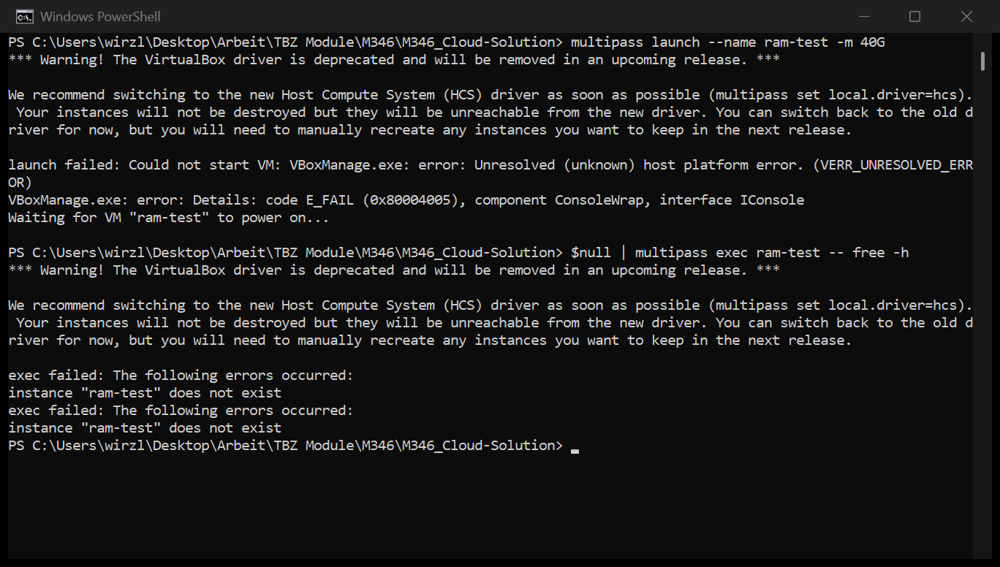

## Fehler 
### Multipass Hash Mismatch Fehler

Beim Versuch, eine Instanz mit Multipass zu starten, habe ich folgenden Fehler erhalten:

```cmd
launch failed: Hash of C:/ProgramData/Multipass/cache/hcs/vault/images/resolute-20261016/ubuntu-26.04-server-cloudimg-amd64.img does not match (expected 5645d0318ad21f643ebb1ac4567514620e9893380b07b0201fda163baa5b7eb5 but got e3b0c44298fc1c149afbf4c8996fb92427ae41e4649b934ca495991b7852b855)
```
Ich habe es zuerst mit `multipass launch --name smoke -c 1 -m 1G -d 5G 26.04` versucht.  
Danach habe ich es einfach mit `multipass launch --name demo` probiert.  
Bei mir kam in beiden Fällen exakt das gleiche Resultat. Es hat keinen Unterschied gemacht, welchen Namen oder welche Parameter ich mitgegeben habe.  
Ich habe jetzt eine Lösung gefunden. Ich habe es zuhause heruntergeladen.

## B) Hypervisor-Experiment

### 1. Vergleich Hypervisor Typen
| Person | Betriebssystem | Multipass-Backend (`local.driver`) | Hypervisor-Typ | Begründung |
| :--- | :--- | :--- | :--- | :--- |
| **Philippe** | Windows 11 Home | `hcs` | **Typ 1** (Bare-Metal) | Obwohl es Windows 11 Home ist nutzt das hcs Backend direkt die eingebaute Windows-Hypervisor-Plattform. Der Hypervisor läuft direkt auf der Hardware unterhalb von Windows. |
| **Lennis** | Windows 11 Home | `virtualbox` | **Typ 2** (Hosted) | VirtualBox läuft als klassische Desktop Anwendung auf dem Host Betriebssystem und greift erst über dieses auf die Hardware zu. |

### 2. Host-Ressourcen

* **Mein Host (Philippe):** 
  

* **Host von Lennis**
  

### 3. Overcommitment Tests 

* **Meine Tests (`hcs`):** 14 logische Prozessoren, 16 GB RAM
  

* **Tests von Lennis (`virtualbox`):** 14 logische Prozessoren, 32 GB RAM
  
  

### 4. Erklärung 

* **Vergleich der Backends (`hcs` und `virtualbox`):** Die beiden Backends reagieren unterschiedlich: Bei meinem `hcs`-Treiber (Typ 1) wird zu viel CPU direkt beim Start blockiert, während mehr RAM als vorhanden akzeptiert wird. Bei Lennis' VirtualBox (Typ 2) wird hingegen zu viel RAM sofort abgelehnt, und beim CPU-Test läuft die VM in einen Timeout.
* **CPU-Overcommitment (Zeitscheiben):** Ein Hypervisor kann CPU-Kerne über Zeitscheiben zwischen mehreren VMs aufteilen, weil nicht jede VM ständig Volllast braucht. Einer einzelnen VM mehr Kerne zuzuweisen, als der PC physisch hat (`-c 20` bzw. `-c 18`), macht aber keinen Sinn und wird bei mir sofort blockiert bei VirtualBox hängt sich die VM dadurch beim Starten komplett auf.
* **RAM-Overcommitment (Swap):** RAM lässt sich nicht in Zeitscheiben aufteilen. Bei `hcs` funktionieren die 24 GB trotzdem, weil die VM erst einmal nur so viel Speicher braucht, wie sie wirklich nutzt, und Windows den Rest über Swap (Auslagerungsdatei) auf die SSD schiebt. VirtualBox prüft dagegen schon vor dem Start, ob die 40 GB wirklich frei sind, und bricht ab, damit der Host-PC nicht abstürzt.
