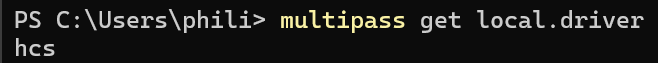
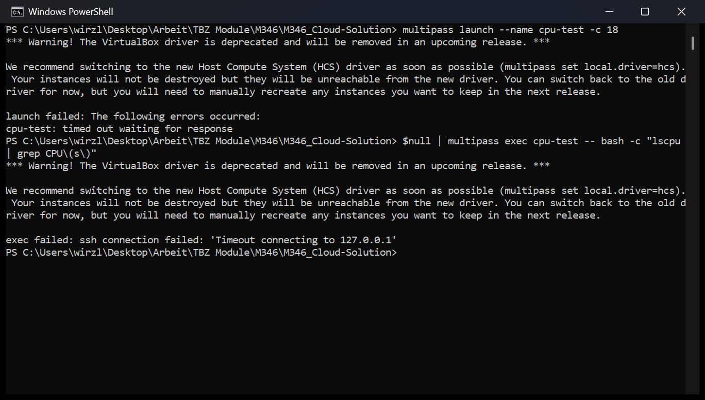
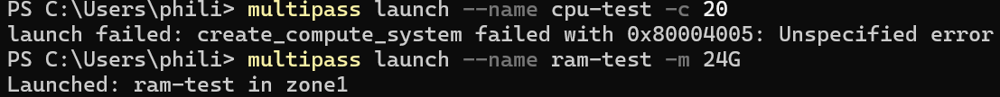

## Fehler 
### Multipass Hash Mismatch Fehler

Beim Versuch, eine Instanz mit Multipass zu starten, habe ich folgenden Fehler erhalten:

```cmd
launch failed: Hash of C:/ProgramData/Multipass/cache/hcs/vault/images/resolute-20261016/ubuntu-26.04-server-cloudimg-amd64.img does not match (expected 5645d0318ad21f643ebb1ac4567514620e9893380b07b0201fda163baa5b7eb5 but got e3b0c44298fc1c149afbf4c8996fb92427ae41e4649b934ca495991b7852b855)
```
Ich habe es zuerst mit `multipass launch --name smoke -c 1 -m 1G -d 5G 26.04` versucht.  
Danach habe ich es einfach mit `multipass launch --name demo` probiert.  
Bei mir kam in beiden Fällen exakt das gleiche Resultat. Es hat keinen Unterschied gemacht, welchen Namen oder welche Parameter ich mitgegeben habe.  
Ich habe jetzt eine Lösung gefunden. Ich habe es zuhause heruntergeladen.

## B) Hypervisor-Experiment

### 1. Vergleich Hypervisor Typen
| Person | Betriebssystem | Multipass-Backend (`local.driver`) | Hypervisor-Typ | Begründung |
| :--- | :--- | :--- | :--- | :--- |
| **Philippe** | Windows 11 Home | `hcs` | **Typ 1** (Bare-Metal) | Obwohl es Windows 11 Home ist nutzt das hcs Backend direkt die eingebaute Windows-Hypervisor-Plattform. Der Hypervisor läuft direkt auf der Hardware unterhalb von Windows. |
| **Lennis** | Windows 11 Home | `virtualbox` | **Typ 2** (Hosted) | VirtualBox läuft als klassische Desktop Anwendung auf dem Host Betriebssystem und greift erst über dieses auf die Hardware zu. |

### 2. Host-Ressourcen

* **Mein Host (Philippe):** 
  

* **Host von Lennis**
  

### 3. Overcommitment Tests 

* **Meine Tests (`hcs`):** 14 logische Prozessoren, 16 GB RAM
  

* **Tests von Lennis (`virtualbox`):** 14 logische Prozessoren, 32 GB RAM
  
  

### 4. Erklärung 

* **Vergleich der Backends (`hcs` vs. `virtualbox`):** Die beiden Backends verhalten sich genau gegensätzlich beim RAM, lehnen aber beide ein CPU-Overcommitment für eine einzelne VM ab. Während mein Typ-1-Backend (`hcs`) den Start mit zu vielen CPUs sofort abblockt und dafür mehr RAM als physisch vorhanden zulässt, blockiert Lennis' Typ-2-Backend (`virtualbox`) den zu grossen RAM sofort beim Start und läuft bei zu vielen vCPUs in einen Boot-Timeout.
* **CPU-Overcommitment (Zeitscheiben):** Ein Hypervisor kann physische CPU-Threads über **Zeitscheiben (Time Slices)** auf mehrere VMs aufteilen, da die Kerne nicht ständig zu 100 % ausgelastet sind. Dass eine *einzelne* VM jedoch mehr virtuelle Prozessoren erhält, als physische Threads existieren (`-c 20` bzw. `-c 18`), wird von `hcs` direkt blockiert und führt bei VirtualBox (das zusätzlich durch die auf Windows aktive Hypervisor-Plattform ausgebremst wird) zu einem Timeout beim Booten, da die vCPUs nicht sauber auf echte Hardware-Threads abgebildet werden können.
* **RAM-Overcommitment (Swap):** Im Gegensatz zur CPU lässt sich RAM nicht in Zeitscheiben aufteilen. Dass bei meinem `hcs`-Backend 24 GB RAM trotzdem funktioniert haben, liegt an **Dynamic Memory** und **Swap (Paging)**: Solange das Gast-System den Speicher nicht komplett ausfüllt, wird auf dem Host nur der tatsächlich belegte RAM verbraucht; bei Überlastung lagert Windows ungenutzte Speicherseiten (*Pages*) auf die SSD in die Auslagerungsdatei (`pagefile.sys`) aus. VirtualBox (Typ 2) hingegen prüft vor dem Start strikt, ob der angeforderte Arbeitsspeicher (40 GB) auf dem 32-GB-Host physisch reserviert werden kann, und verweigert den Start (`E_FAIL`), um das Host-Betriebssystem vor dem Einfrieren zu schützen.
